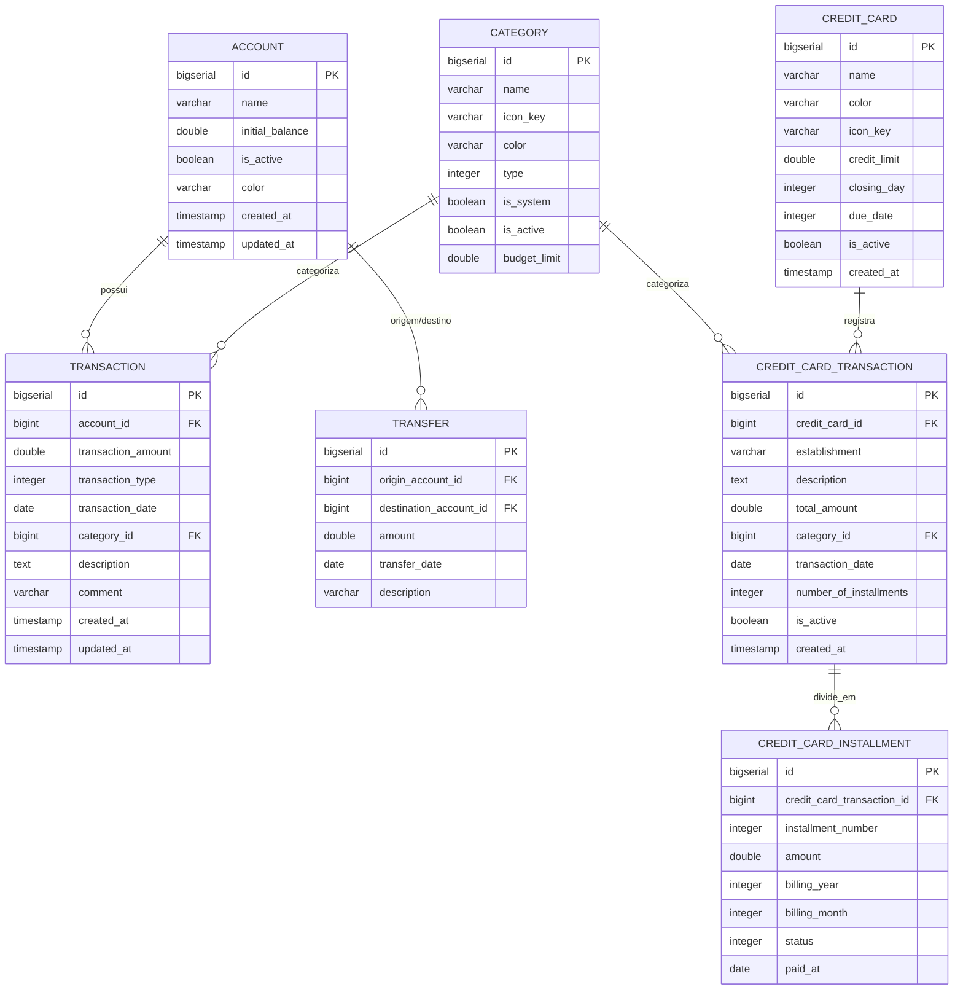

# 💰 Expenses Service

Backend RESTful desenvolvido em **Kotlin** e **Spring Boot 3** para **Controle Financeiro Pessoal e Gestão de Orçamento**. O sistema permite registrar e categorizar todas as movimentações financeiras, calcular saldos automaticamente, gerenciar contas bancárias e controlar cartões de crédito, parcelamentos e faturas futuras.

---

## 📌 Sumário

- [Visão Geral e Propósito](#-visão-geral-e-propósito)
- [Tecnologias e Bibliotecas](#-tecnologias-e-bibliotecas)
- [Arquitetura e Padrões de Código](#-arquitetura-e-padrões-de-código)
- [Estrutura do Projeto](#-estrutura-do-projeto)
- [Modelo de Dados](#-modelo-de-dados)
- [Documentação da API (Endpoints)](#-documentação-da-api-endpoints)
  - [Contas (`/api/account`)](#1-contas-apiaccount)
  - [Categorias (`/api/category`)](#2-categorias-apicategory)
  - [Transações (`/api/transaction`)](#3-transações-apitransaction)
  - [Cartões de Crédito (`/api/credit-card`)](#4-cartões-de-crédito-apicredit-card)
- [Como Executar o Projeto](#-como-executar-o-projeto)
  - [Pré-requisitos](#pré-requisitos)
  - [Execução Local com Gradle](#execução-local-com-gradle)
  - [Execução com Docker](#execução-com-docker)
  - [Depuração Remota (Debug Mode)](#depuração-remota-debug-mode)
- [Configurações e Variáveis de Ambiente](#-configurações-e-variáveis-de-ambiente)
- [Testes Automatizados](#-testes-automatizados)
- [Status de Desenvolvimento e Roadmap](#-status-de-desenvolvimento-e-roadmap)

---

## 🎯 Visão Geral e Propósito

O objetivo central do projeto é fornecer uma API confiável e eficiente que espelhe a realidade financeira do usuário sob o princípio: *"Nada sai ou entra sem ser registrado e categorizado"*.

### Principais Capacidades:
1. **Gestão de Contas Bancárias / Carteiras**: Registro de saldos iniciais, acompanhamento automático do saldo em tempo real (calculado a partir das transações associadas) e controle de ativação/inativação de contas.
2. **Classificação por Categorias**: Organização visual e analítica de receitas e despesas com suporte a categorias do sistema e categorias personalizadas pelo usuário, cores e limites de orçamento (*budget limit*).
3. **Lançamento de Transações**: Registro de receitas e despesas com impacto imediato no saldo da respectiva conta, validação de regras temporais e pesquisa com múltiplos filtros.
4. **Gestão de Cartão de Crédito e Faturas**: Modelagem de cartões de crédito com controle de limite, dias de fechamento e vencimento, suporte a despesas parceladas e geração de parcelas (*installments*) distribuídas entre faturas futuras.
5. **Dashboard e Métricas (Em evolução)**: Base de dados estruturada para consolidação de patrimônio líquido, balanço mensal e distribuição de despesas por categoria.

---

## 🛠 Tecnologias e Bibliotecas

| Categoria | Tecnologia / Dependência | Versão | Propósito |
| :--- | :--- | :--- | :--- |
| **Linguagem** | [Kotlin](https://kotlinlang.org/) | `1.9.25` | Linguagem base orientada a objetos e funcional |
| **Plataforma JVM** | [Java SE](https://openjdk.org/) | `21` | LTS Java Toolchain |
| **Framework Core** | [Spring Boot](https://spring.io/projects/spring-boot) | `3.5.7` | Estrutura central da aplicação web e injeção de dependências |
| **Persistência / ORM** | Spring Data JPA / Hibernate | - | Mapeamento objeto-relacional e abstração de repositórios |
| **Plugins Kotlin** | `plugin.spring`, `plugin.jpa` | `1.9.25` | Suporte a classes abertas (`allOpen`) e construtores vazios para entidades JPA |
| **Banco de Dados** | [PostgreSQL](https://www.postgresql.org/) | `15+` | Banco de dados relacional principal |
| **Driver BD** | PostgreSQL JDBC Driver | - | Driver de conexão JDBC |
| **Migrations** | [Flyway](https://flywaydb.org/) | - | Versionamento e migração automatizada do esquema SQL |
| **Serialização JSON** | Jackson (`jackson-module-kotlin`) | - | Serialização e desserialização de modelos Kotlin/JSON |
| **Reflexão** | `kotlin-reflect` | `1.9.25` | Introspecção em tempo de execução para frameworks |
| **Monitoramento** | Spring Boot Actuator | - | Endpoints de saúde e métricas operacionais |
| **Ambiente de Testes** | JUnit 5 & [Testcontainers](https://testcontainers.com/) | - | Testes de integração conteinerizados com PostgreSQL real |
| **Containerização** | Docker | - | Ambientes isolados para desenvolvimento e produção |

---

## 🏛 Arquitetura e Padrões de Código

A aplicação segue uma **Arquitetura em Camadas (Layered Architecture)** com separação estrita de responsabilidades:

```
src/main/kotlin/br/com/money/expenses/
├── config/        # Configurações do ecossistema Spring (CORS, inicializações)
├── controller/    # Camada REST (Controllers): entrada HTTP, validações e respostas
├── enum/          # Enumerações de domínio (tipos de transações, status de parcelas)
├── exceptions/    # Exceções de domínio específicas
├── handler/       # Tratamento global de exceções (@ControllerAdvice, RFC 7807)
├── model/
│   ├── dto/       # Data Transfer Objects com validações e métodos de mapeamento
│   └── entity/    # Entidades JPA com suporte a Data Classes e relacionamentos
├── repository/    # Interfaces JPA Repositories (queries derivadas, JPQL e SQL nativo)
└── service/       # Interfaces e implementações das regras de negócio (@Service)
```

### Padrões e Práticas Notáveis:
- **Separação DTO / Entidade**: As entidades do banco nunca são expostas diretamente nos endpoints REST. Há conversão explícita através de métodos de fábrica estáticos `fromModel(...)` nos DTOs.
- **Validação com Extension Functions / Companions**: Validações de requisição são encapsuladas nos próprios DTOs (ex.: `CreateAccountRequestDto.validate()`), garantindo contratos consistentes antes do repasse à camada de serviço.
- **Imutabilidade e Idiomatismo Kotlin**: Uso de Kotlin `data class` com `copy(...)` para alterações parciais de estado em entidades e objetos de transferência.
- **Cálculo Dinâmico de Saldo**: O saldo atual das contas não depende de campos estáticos frágeis que podem dessincronizar; ele é computado diretamente a partir do saldo inicial somado às transações registradas via agregação agregada no banco de dados (`TransactionRepository.getChangeInBalanceByAccountId` e `getSumsByAccountId`).
- **JPA & Kotlin All-Open Plugin**: Configuração do plugin `allOpen` para anotações `@Entity`, `@MappedSuperclass` e `@Embeddable`, permitindo lazy loading sem que o Hibernate enfrente incompatibilidade de classes `final`.
- **Tratamento Centralizado de Erros**: `@ControllerAdvice` padronizado utilizando `ErrorResponse` compatível com o padrão RFC 7807 do Spring Boot 3.

---

## 📂 Estrutura do Projeto

```
expenses-back/
├── build.gradle.kts           # Configuração de build, plugins e dependências Gradle
├── settings.gradle.kts        # Nome do projeto e configurações gerais
├── Dockerfile.dev             # Imagem para desenvolvimento com hot reload e live debug
├── Dockerfile.prod            # Imagem de produção multi-stage otimizada (JRE 21 alpine)
├── HELP.md                    # Notas originais do Spring Initializr
├── Idea.md                    # Documento de especificações e requisitos de negócio (MVP)
├── README.md                  # Documentação completa do projeto
└── src/
    ├── main/
    │   ├── kotlin/br/com/money/expenses/
    │   │   ├── config/
    │   │   │   ├── CorsConfig.kt
    │   │   │   └── MockDataLoader.kt
    │   │   ├── controller/
    │   │   │   ├── AccountController.kt
    │   │   │   ├── CategoryController.kt
    │   │   │   ├── CreditCardController.kt
    │   │   │   └── TransactionController.kt
    │   │   ├── enum/
    │   │   │   ├── CreditCardInstallmentStatus.kt
    │   │   │   └── TransactionType.kt
    │   │   ├── exceptions/
    │   │   │   ├── AccountNotFoundException.kt
    │   │   │   ├── CategoryNotFoundException.kt
    │   │   │   ├── CreditCardNotFoundException.kt
    │   │   │   ├── InsufficientBalanceException.kt
    │   │   │   ├── InvalidTransactionException.kt
    │   │   │   └── TransactionNotFoundException.kt
    │   │   ├── handler/
    │   │   │   └── ExceptionHandler.kt
    │   │   ├── model/
    │   │   │   ├── dto/
    │   │   │   │   ├── account/
    │   │   │   │   ├── category/
    │   │   │   │   ├── createCardTransaction/
    │   │   │   │   ├── creditCard/
    │   │   │   │   └── transaction/
    │   │   │   └── entity/
    │   │   │       ├── Account.kt
    │   │   │       ├── Category.kt
    │   │   │       ├── CreditCard.kt
    │   │   │       ├── CreditCardInstallment.kt
    │   │   │       ├── CreditCardTransaction.kt
    │   │   │       ├── Transaction.kt
    │   │   │       └── Transfer.kt
    │   │   ├── repository/
    │   │   │   ├── AccountRepository.kt
    │   │   │   ├── CategoryRepository.kt
    │   │   │   ├── CreditCardInstallmentRepository.kt
    │   │   │   ├── CreditCardRepository.kt
    │   │   │   ├── CreditCardTransactionRepository.kt
    │   │   │   ├── TransactionRepository.kt
    │   │   │   └── TransferRepository.kt
    │   │   ├── service/
    │   │   │   ├── AccountService.kt
    │   │   │   ├── CategoryService.kt
    │   │   │   ├── CreditCardService.kt
    │   │   │   ├── TransactionService.kt
    │   │   │   └── impl/
    │   │   └── ExpensesApplication.kt
    │   └── resources/
    │       ├── application.properties
    │       └── db/migration/
    │           ├── V1__init_schema.sql
    │           └── V2__credit_card_tables.sql
    └── test/
        └── kotlin/br/com/money/expenses/
            └── ExpensesApplicationTests.kt
```

---

## 🗄 Modelo de Dados

O banco de dados relacional é mantido pelo **Flyway**. As migrações definem as seguintes entidades:



### Enums do Sistema:
- **`TransactionType`**:
  - `1`: `INCOME` (Receita - incrementa saldo)
  - `2`: `EXPENSE` (Despesa - decrementa saldo)
- **`CreditCardInstallmentStatus`**:
  - `1`: `OPEN` (Em aberto)
  - `2`: `PAID` (Paga / Liquidada)

---

## 📡 Documentação da API (Endpoints)

Base URL: `http://localhost:8080`

### 1. Contas (`/api/account`)

| Método | Endpoint | Descrição |
| :--- | :--- | :--- |
| `GET` | `/api/account` | Retorna todas as contas com o saldo atual calculado |
| `GET` | `/api/account/{id}` | Busca conta específica por ID |
| `POST` | `/api/account` | Cria uma nova conta bancária/carteira |
| `PATCH` | `/api/account/{id}/edit` | Atualiza nome e cor da conta |
| `PATCH` | `/api/account/{id}/balance` | Atualiza o saldo base/inicial da conta |
| `PATCH` | `/api/account/{id}/deactivate` | Desativa a conta (inativação lógica sem apagar histórico) |
| `GET` | `/api/account/health` | Healthcheck do serviço de contas |

#### Exemplo de Payload - Criação de Conta:
```json
POST /api/account
Content-Type: application/json

{
  "name": "NuBank Corrente",
  "balance": 1500.50,
  "color": "purple"
}
```

---

### 2. Categorias (`/api/category`)

| Método | Endpoint | Descrição |
| :--- | :--- | :--- |
| `GET` | `/api/category` | Lista todas as categorias registradas |
| `GET` | `/api/category/type/{type}` | Filtra categorias por tipo (`1` = Receita, `2` = Despesa) |
| `POST` | `/api/category` | Cadastra uma nova categoria |
| `PATCH` | `/api/category/{id}` | Edita os dados de uma categoria existente |
| `PATCH` | `/api/category/{id}/deactivate` | Inativa a categoria |

#### Exemplo de Payload - Criação de Categoria:
```json
POST /api/category
Content-Type: application/json

{
  "name": "Supermercado",
  "iconKey": "ShoppingCart",
  "color": "#10B981",
  "type": "EXPENSE",
  "budgetLimit": 1200.00
}
```

---

### 3. Transações (`/api/transaction`)

| Método | Endpoint | Descrição |
| :--- | :--- | :--- |
| `POST` | `/api/transaction` | Registra uma nova transação (atualizando o saldo da conta) |
| `GET` | `/api/transaction/{id}` | Retorna uma transação por ID |
| `PATCH` | `/api/transaction/{id}/update` | Atualiza dados de uma transação |
| `DELETE` | `/api/transaction/{id}/delete` | Exclui uma transação existente |
| `GET` | `/api/transaction/search` | Pesquisa transações com múltiplos filtros |

#### Parâmetros de Busca (`GET /api/transaction/search`):
- `accountId` *(Long, opcional)*: Filtra por conta.
- `categoryId` *(Long, opcional)*: Filtra por categoria.
- `type` *(String, opcional)*: Filtra por tipo (`INCOME` ou `EXPENSE`).
- `startDate` *(LocalDate `YYYY-MM-DD`, opcional)*: Data inicial.
- `endDate` *(LocalDate `YYYY-MM-DD`, opcional)*: Data final.
- `searchTerms` *(String, opcional)*: Busca textual em descrições.

#### Exemplo de Payload - Criação de Transação:
```json
POST /api/transaction
Content-Type: application/json

{
  "accountId": 1,
  "categoryId": 2,
  "type": "EXPENSE",
  "amount": 89.90,
  "transactionDate": "2026-10-14",
  "description": "Almoço de domingo",
  "comment": "Restaurante com a família"
}
```

---

### 4. Cartões de Crédito (`/api/credit-card`)

| Método | Endpoint | Descrição |
| :--- | :--- | :--- |
| `GET` | `/api/credit-card` | Lista todos os cartões de crédito ativos |
| `GET` | `/api/credit-card/{id}` | Busca cartão por ID |
| `POST` | `/api/credit-card` | Cadastra um novo cartão de crédito |
| `PATCH` | `/api/credit-card/{id}` | Atualiza informações de limite, dias de fechamento e vencimento |
| `PATCH` | `/api/credit-card/{id}/deactivate` | Inativa um cartão de crédito |

#### Exemplo de Payload - Criação de Cartão:
```json
POST /api/credit-card
Content-Type: application/json

{
  "name": "Cartão XP Visa Infinite",
  "color": "black",
  "iconKey": "CreditCard",
  "limit": 10000.00,
  "closingDay": 25,
  "dueDate": 5
}
```

---

## 🚀 Como Executar o Projeto

### Pré-requisitos
- **Java JDK 21** instalado
- **PostgreSQL 15+** rodando ou **Docker**

---

### Execução Local com Gradle

1. Certifique-se de que o PostgreSQL está em execução e crie o banco de dados:
   ```sql
   CREATE DATABASE expenses_dev;
   ```

2. Configure as credenciais no arquivo `src/main/resources/application.properties` ou via variáveis de ambiente.

3. Execute a aplicação via Gradle Wrapper:
   ```bash
   ./gradlew bootRun
   ```

A API estará disponível em `http://localhost:8080`. O Flyway executará as migrações automaticamente na inicialização.

---

### Execução com Docker

#### 1. Ambiente de Desenvolvimento (`Dockerfile.dev`)
O arquivo `Dockerfile.dev` é preparado para montar a aplicação com suporte a hot reload e porta de depuração remota (*JDWP*):

```bash
docker build -f Dockerfile.dev -t expenses-back:dev .
docker run -p 8080:8080 -p 5005:5005 --name expenses-backend-dev expenses-back:dev
```

#### 2. Ambiente de Produção (`Dockerfile.prod`)
O `Dockerfile.prod` realiza um *multi-stage build*, gerando uma imagem JRE 21 leve com Alpine Linux e usuário não-root (`spring:spring`):

```bash
docker build -f Dockerfile.prod -t expenses-back:prod .
docker run -p 8080:8080 -e SPRING_PROFILES_ACTIVE=prod --name expenses-backend-prod expenses-back:prod
```

---

### Depuração Remota (Debug Mode)
Ao rodar com `Dockerfile.dev`, a porta `5005` é exposta para depuração remota JDWP. No IntelliJ IDEA ou VS Code:
- Conecte um debugger remoto em `localhost:5005`.

---

## ⚙ Configurações e Variáveis de Ambiente

As principais propriedades configuráveis no `application.properties`:

| Propriedade | Padrão | Descrição |
| :--- | :--- | :--- |
| `server.port` | `8080` | Porta HTTP da aplicação |
| `spring.datasource.url` | `jdbc:postgresql://db:5432/expenses_dev` | URL de conexão JDBC |
| `spring.datasource.username` | `admin` | Usuário do banco de dados |
| `spring.datasource.password` | `admin` | Senha do banco de dados |
| `spring.jpa.hibernate.ddl-auto` | `validate` | Valida integridade das entidades com o banco sem alterar o schema |
| `spring.flyway.enabled` | `true` | Ativa o Flyway para migrações |
| `spring.flyway.locations` | `classpath:db/migration` | Diretório dos scripts SQL de migração |

### Política de CORS (`CorsConfig.kt`)
Permite requisições dos seguintes endereços (configurado para integração com frontends React/Next):
- `http://localhost:3000`
- `http://127.0.0.1:3000`
- `http://frontend:3000`

---

## 🧪 Testes Automatizados

O projeto utiliza **JUnit 5** e **Testcontainers** para testes de integração de ponta a ponta sem necessidade de um banco de dados local pré-instalado:

```bash
./gradlew test
```

Durante a execução dos testes, uma instância temporária do container PostgreSQL (`postgres:15-alpine`) é iniciada de forma transparente, as migrações do Flyway são aplicadas e os testes de contexto e repositório são validados.

---

## 🗺 Status de Desenvolvimento e Roadmap

Baseado no planejamento do produto (`Idea.md`):

- [x] **Contas (Accounts)**: Criação, listagem com cálculo de saldo em tempo real, inativação e edição.
- [x] **Categorias (Categories)**: Categorização de receitas/despesas, suporte a cores, ícones e limites de orçamento.
- [x] **Transações (Transactions)**: Cadastro com validações de data e valor, busca com múltiplos filtros, exclusão e edição.
- [x] **Cartões de Crédito (Credit Cards)**: Cadastro de cartões com limites e datas de corte/vencimento.
- [ ] **Faturas e Parcelamento de Cartão**: Finalizar os endpoints e regras de negócios para compra parcelada e consolidação de fatura mensal (`CreditCardInstallment` e `CreditCardTransaction`).
- [ ] **Módulo de Transferências**: Implementar endpoints e lógica transacional para transferências entre contas (`Transfer`).
- [ ] **Dashboard Consolidado**: Endpoints para consolidação de patrimônio líquido (saldo de contas deduzindo faturas futuras), balanço do mês e métricas por categoria.
- [ ] **Controle de Dinheiro Emprestado**: Feature planejada para gerenciar valores devidos por terceiros, parcelas a receber e amortizações.
